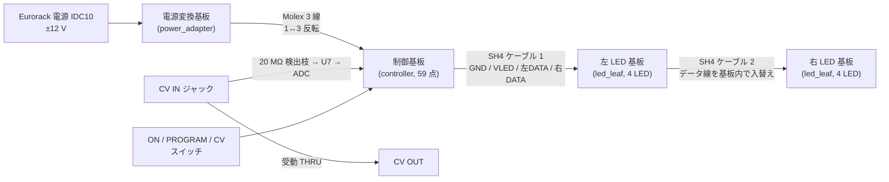

## ブロック図

## 基板

| 基板 | 枚数 | 実装点数 | 状態 (記録) |
|---|---:|---:|---|
| 制御基板 `controller` | 1 | 59 | 配置済み・**未配線**。未接続 130、コートヤード重なり 2 件 (J3-H1, J3-C7) |
| LED 基板 `led_leaf` (同一設計) | 2 | 10 × 2 | 配線済み。DRC 違反 0、未接続 0 |
| 電源変換基板 `power_adapter` | 1 | 2 | 配線済み。DRC 違反 0、未接続 0 |

3 種類のネイティブ設計で 4 枚の物理基板になります。1 台あたり **30 型番・81 点** です ([部品表](./bom.mdx))。

## 信号と電源

- MCU (STM32G031G8U6TR) の PA6 / PA7 (TIM3) から、左右それぞれ 4 画素の **独立した 2 本のデータ列** を出します。1 本の 8 画素チェーンではありません。
- 最初のケーブル (制御 J3 → 左 J1) は、左右両方の LED 基板の電流を運びます。共通の TPS2552-1 電流制限の計算値は約 343〜439 mA で、ソフトウェアの明るさ上限とは別のものです。
- ±12 V は IDC10 から電源変換基板を通り、ピン 1 と 3 が入れ替わる Molex ケーブルで制御基板へ入ります。制御基板で 5 V 降圧と 3.3 V LDO を作ります。
- CV IN から OUT へは受動 THRU で直結し、20 MΩ の検出枝と U7 (TLV9001) を通して ADC で読みます。

## 動作モード

| スイッチ位置 | 意味 |
|---|---|
| ON | 全 LED を白で点灯 (試作の初期値) |
| 中央 (物理 OFF 接点) | **PROGRAM** — 電源 OFF ではありません |
| CV | CV の大きさで明るさ、符号で暖色 / 寒色 |

詳細は [ファームウェア](./firmware.mdx) を参照してください。
